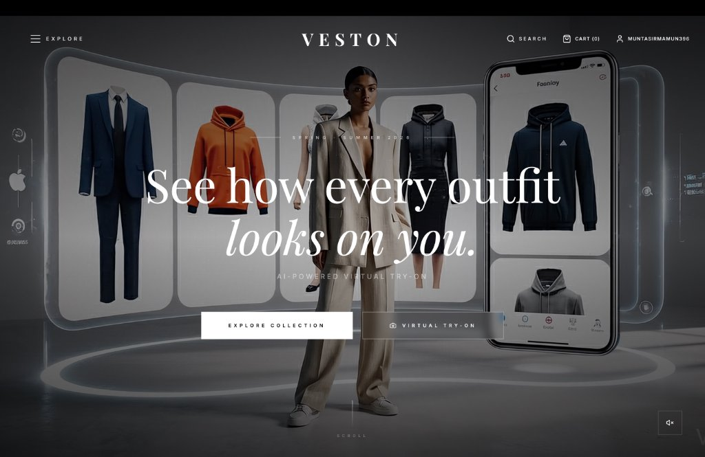
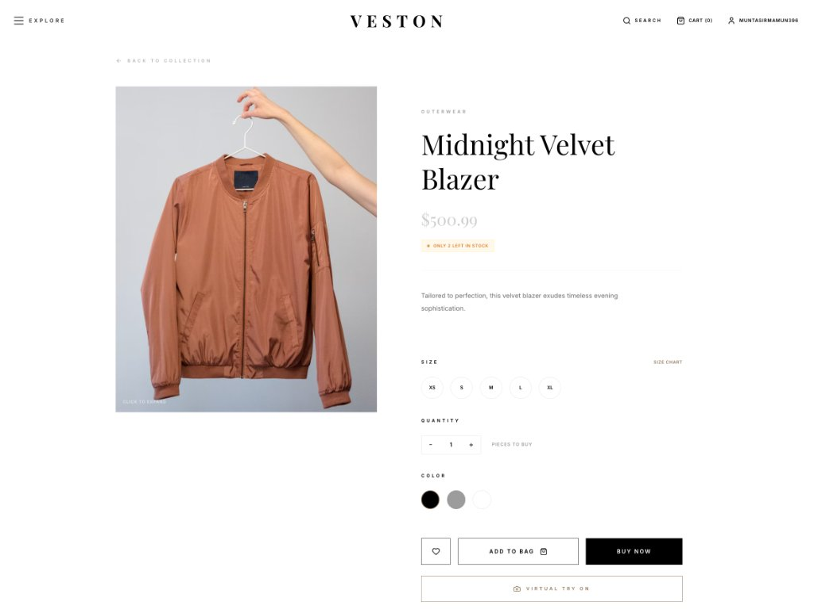
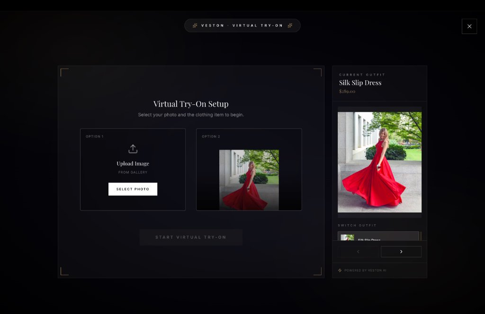

# VESTON — Luxury E-Commerce & AI-Powered Virtual Try-On

<p align="center">
  
</p>

<p align="center">
  <strong>Experience fashion before you buy. See how every outfit looks on you with AI-driven virtual fitting.</strong>
</p>

<p align="center">
  
  
  
  
  
  
</p>

---

## 🌟 Overview

**VESTON** is an intelligent, high-end luxury fashion e-commerce web platform integrating modern shopping experiences with generative AI virtual try-on capabilities. Customers can browse curated collections, view garments in high fidelity, and virtually preview outfits tailored to their own uploaded photos powered by custom ComfyUI workflows.

---

## 📸 Screenshots

| 🛍️ Product View & Try-On | 🪄 Virtual Try-On Setup |
| :---: | :---: |
|  |  |
| *Tailored product showcase with intuitive size, color selection, and instant Try-On trigger.* | *Upload user photo or choose sample model to initiate the AI garment fitting pipeline.* |

---

## ✨ Features

- **👗 Next-Gen E-Commerce Experience**: Seamless navigation, fluid animations, dynamic product filtering, responsive cart, and streamlined checkout.
- **🪄 AI Virtual Try-On Pipeline**: Direct integration with ComfyUI workflow backend to process user images and seamlessly drape selected garments onto users.
- **🔍 Interactive Product View**: High-resolution zoom, image galleries, color swatches, size selectors, and real-time inventory tracking.
- **🛡️ Comprehensive Admin Portal**:
  - Live revenue & order analytics with interactive charts
  - Product catalog & inventory management
  - Order processing & fulfillment workflows
  - Customer accounts & role-based access control
  - Dynamic marketing banners, discount coupon engine, and audit logs
- **🔐 Secure Backend & Storage**: Supabase integration for authenticated sessions, role-based database policies, and asset storage.

---

## 🛠️ Tech Stack

- **Frontend**: React 19, TypeScript, Vite, Tailwind CSS v4, Lucide Icons, Framer Motion, Recharts
- **Backend**: Node.js, Express, Multer (in-memory file processing), Helmet, CORS, Morgan
- **Database & Services**: Supabase (PostgreSQL, Auth, Storage)
- **AI Engine**: ComfyUI API integration for virtual try-on image generation

---

## 🚀 Getting Started

### Prerequisites
- [Node.js](https://nodejs.org/) (v18 or higher recommended)
- [npm](https://www.npmjs.com/) or [yarn](https://yarnpkg.com/)
- [Supabase](https://supabase.com/) account & project

### 1. Clone the Repository
```bash
git clone https://github.com/muntasir-396/VESTON.git
cd VESTON
```

### 2. Install Dependencies
```bash
npm install --legacy-peer-deps
```

### 3. Configure Environment Variables
Create a `.env` file in the root directory (based on `.env.example`):
```env
# Server URL
APP_URL="http://localhost:3000"

# Supabase Credentials
VITE_SUPABASE_URL="https://your-project.supabase.co"
VITE_SUPABASE_ANON_KEY="your-anon-api-key"

# ComfyUI Backend (Optional, for live virtual try-on workflow)
COMFYUI_API_URL="http://127.0.0.1:8188"
```

### 4. Database Setup
Execute the database schema and migration scripts in your Supabase SQL editor:
- [`admin_schema.sql`](admin_schema.sql)
- [`supabase_migrations.sql`](supabase_migrations.sql)

Optional: Seed initial admin & demo products:
```bash
npx tsx seed-supabase.ts
npx tsx seed-admin.ts
```

### 5. Run the Application
Start the development server:
```bash
npm run dev
```

Open your browser and navigate to:
```
http://localhost:3000
```

---

## 📦 Scripts

| Command | Description |
| :--- | :--- |
| `npm run dev` | Starts the Express server with Vite HMR on port 3000 |
| `npm run build` | Compiles frontend assets for production |
| `npm start` | Runs the production server |
| `npm run lint` | Runs TypeScript type checking |
| `npm run clean` | Removes `dist` build directory |

---

## 📄 License

This project is licensed under the terms specified in the [LICENSE](LICENSE) file.
